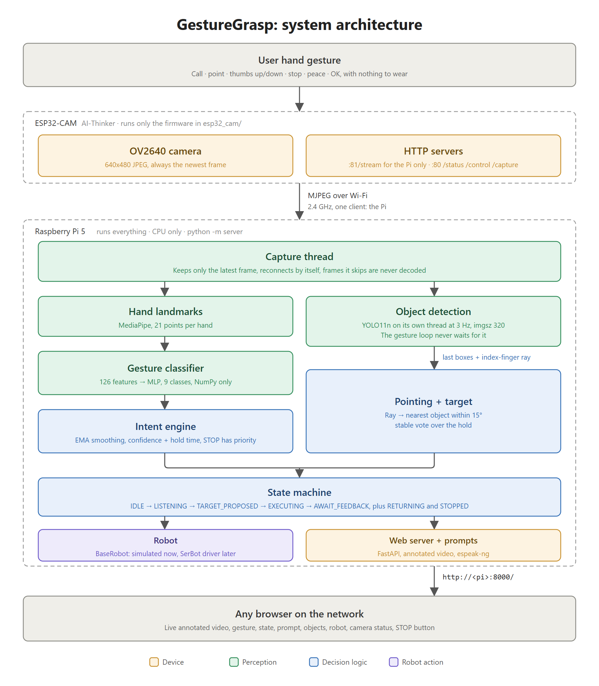
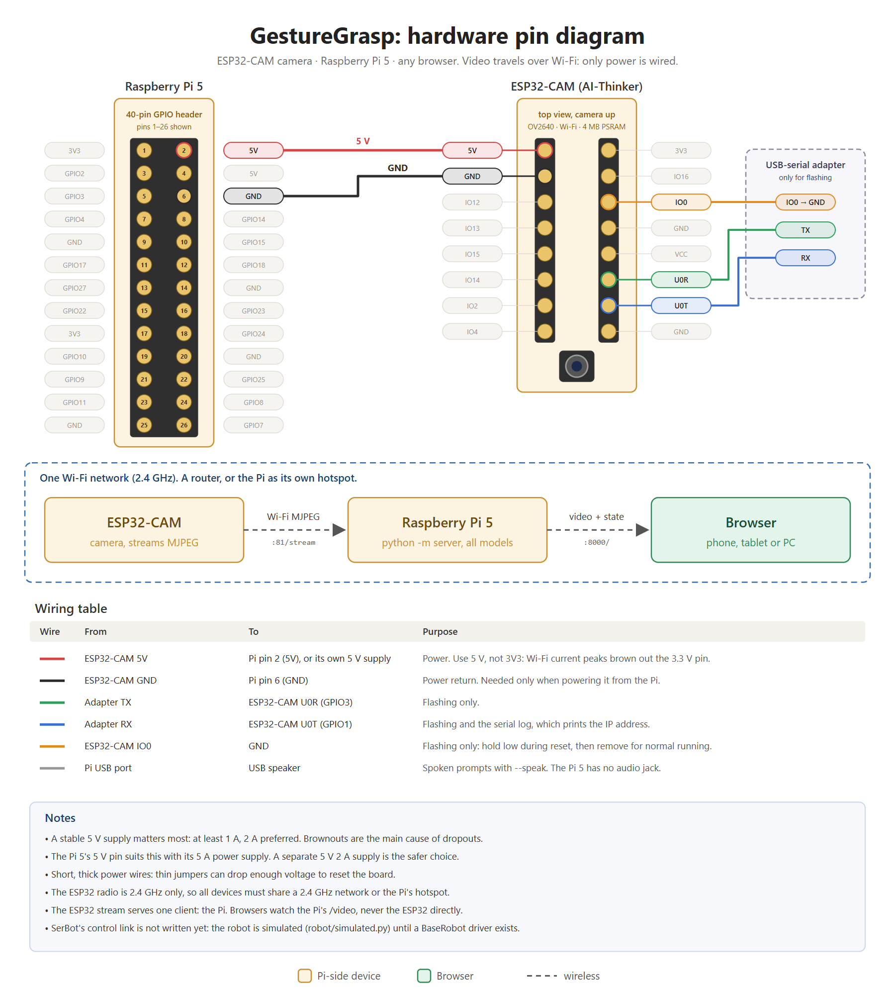

<div align="center">

# 🤙 GestureGrasp

### Hand-sign control for an assistive fetching robot

**Point at a bottle, give a thumbs up, and the robot brings it to you.**

<p>
  
  
  
  
  
  
</p>

<p>
  
  
  
  
</p>

[Quick start](#-quick-start) · [Gestures](#-the-gestures) · [The web page](#-the-web-page) · [How it works](#-how-it-works) · [Results](#-results) · [Hardware](#-hardware) · [Docs](#-documentation)

</div>

---

## 💡 Why

Speech and touch controls are hard for many of the people who would benefit most from a helper robot:
older adults, people with Parkinson's, people with missing fingers or stiff joints. GestureGrasp lets
them ask for an object with a few simple, forgiving hand signs. No wearable, no app, no voice.

- 🖐️ **Forgiving by design:** small tremor is fine, either hand works, gestures can be tilted, and an
  open palm with spread fingers still counts as STOP.
- 🛑 **Safety first:** STOP has the shortest hold, always wins, and `POST /stop` works without a token
  so anyone in the room can halt the robot.
- 🙅 **Ignores everyday hands:** fists, resting hands, holding a cup and other signs are trained as
  "not a command".
- ✅ **Nothing moves without confirmation:** every target is proposed first and needs a thumbs up.

---

## 🧭 How it works

Two devices do everything: an **AI-Thinker ESP32-CAM** and a **Raspberry Pi 5**. The ESP32-CAM streams
video over Wi-Fi. The Pi runs the whole pipeline on its CPU and serves a web page that any phone or
computer on the network can open. A GPU PC is only needed to retrain the model.

<p align="center">
  
</p>

```
ESP32-CAM ──MJPEG over Wi-Fi──► Raspberry Pi 5: capture → hands → model → intent → pointing/YOLO → state machine → robot
                                     └──► http://<pi>:8000/ on any browser
```

| Stage | What it does |
|---|---|
| **Capture** | A background thread reads the MJPEG stream and keeps only the newest frame, so a slow pipeline skips frames instead of acting on old ones. Reconnects by itself |
| **Hand landmarks** | MediaPipe Hands finds 21 points per hand |
| **Gesture classifier** | 126 features (positions, bend angles, fingertip distances, roll) → MLP (126 → 512 → 256 → 128 → 9), temperature-calibrated, running in NumPy |
| **Intent engine** | Smooths confidence over frames, needs a full hold before a command fires, STOP has priority |
| **Pointing + YOLO** | YOLO11n runs on its own thread at 3 Hz, so the gesture loop never waits for it. A ray along the index finger picks the nearest allowed object within 15°, voted over the hold |
| **State machine** | `IDLE → LISTENING → TARGET_PROPOSED → EXECUTING → AWAIT_FEEDBACK`, plus `RETURNING` and `STOPPED`. Only accepts commands that make sense in the current step |
| **Robot** | `BaseRobot` interface. A simulated robot drives, grasps and delivers until real hardware is connected |

Every gesture, hold time, threshold, state and object lives in one file:
[`configs/intents.yaml`](configs/intents.yaml).

---

## ✋ The gestures

Hold a gesture steady for its hold time and it fires once.

| | Gesture | Command | Hold | What happens |
|:-:|---|---|:-:|---|
| 🤙 | **Call me** | `WAKE` | 0.6 s | Wakes the system; it starts listening |
| 👉 | **Point** | `SELECT_TARGET` | 0.8 s | Proposes the object you point at. Nothing moves yet |
| 👍 | **Thumbs up** | `CONFIRM` | 0.7 s | The robot fetches the proposed object |
| 👎 | **Thumbs down** | `REJECT` | 0.7 s | Cancels the proposal (or a wrong delivery) so you can point again |
| ✋ | **Stop** | `STOP` | 0.25 s | Emergency stop, at any time |
| ✌️ | **Peace** | `RETURN_HOME` | 1.0 s | Cancels the task and sends the robot to its dock |
| 👌 | **OK** | `ACKNOWLEDGE` | 0.8 s | You have the object: the robot lets go and goes home |

**A complete fetch:**

```
🤙 Call me      →  "Point at the object you want."
👉 Point        →  "Thumbs up to fetch the bottle, thumbs down to choose again."
👍 Thumbs up    →  "Fetching the bottle."   (robot drives, grasps, brings it to you)
                   "Here is the bottle. Show OK when done, thumbs down if it is wrong."
👌 OK           →  robot hands it over and returns to the dock
```

**Objects you can point at:** `bottle`, `cup`, `cell phone`, `remote`, `book`, `mouse`, `apple`, `banana`.

Full details, reliability per gesture and tips for users: **[GESTURES.md](GESTURES.md)**.

---

## 🚀 Quick start

### 1. Flash the ESP32-CAM

Put your Wi-Fi details in [`esp32_cam/config.h`](esp32_cam/config.h) and flash
[`esp32_cam/esp32_cam.ino`](esp32_cam/esp32_cam.ino). Full steps: **[esp32_cam/README.md](esp32_cam/README.md)**.

### 2. Set up the Raspberry Pi 5

Raspberry Pi OS **Bookworm 64-bit** (Python 3.11).

```bash
sudo apt install -y python3-venv espeak-ng libgl1 libglib2.0-0 libportaudio2 avahi-daemon libnss-mdns
git clone https://github.com/Swastik-59/serbot.git && cd serbot
python3 -m venv .venv && source .venv/bin/activate
pip install --extra-index-url https://download.pytorch.org/whl/cpu -r requirements-pi.txt
python scripts/export_yolo_pi.py       # once, online: picks the fastest YOLO backend for this Pi
```

### 3. Run it

```bash
python -m server --camera-url http://esp32cam.local:81/stream
```

Then open **http://\<pi-ip\>:8000/** on any device on the same network.

<details>
<summary><b>Server options</b></summary>

```bash
python -m server --camera-url http://192.168.1.50:81/stream   # use the IP if .local does not resolve
python -m server --speak                                      # speak prompts on the Pi
python -m server --flip both                                  # camera mounted upside down (h, v, both)
python -m server --token mysecret                             # require a secret for /reset, /infer, /ws/stream
python -m server --mock-detector                              # fixed fake objects instead of YOLO
python -m server --source clip.mp4                            # a video file or image instead of the camera
python -m server --max-hands 1                                # about twice as fast; see GUIDE.md section 2.6
```

Every flag has a `SERBOT_*` environment variable. To start on boot, use
[`deploy/gesturegrasp.service`](deploy/gesturegrasp.service) (GUIDE.md section 3).

</details>

> **No hardware?** On any PC: `python -m server --source some_photo.jpg --mock-detector`, then open
> http://localhost:8000/. The webcam tab also works there.

---

## 🎮 The web page

`http://<pi>:8000/` shows the annotated video from the ESP32-CAM and explains, in plain words, what the
model reads from your hand: *"You're pointing at the **bottle**."* It works on a phone.

| Panel | Shows |
|---|---|
| **The sentence** | A plain-language reading of your hand, a hold bar and a "Sent ✓" badge when a command fires |
| **Camera badge** | Connected or lost, frames per second, frame age, Wi-Fi signal |
| **What the model sees** | Confidence for all 9 classes, with the threshold each gesture needs |
| **Decision** | Confidence vs. required, lead over the runner-up, hold time, and why it did or didn't fire |
| **Pointing & objects** | The target, how far off-centre, how steady, and every detected object |
| **Speed** | Server time, camera-to-result time, frames per second |
| **The robot** | Task step by step, a top-down map of the robot moving, and the command log |

The sources are **ESP32-CAM (via Pi)**, the default, plus **your webcam** and **an uploaded photo** for
development. *Speak prompts here* reads each prompt aloud in the browser.

---

## 🔌 API

| Endpoint | Purpose |
|---|---|
| `GET /` · `/playground` | The web page |
| `GET /viewer` | Minimal page for old devices: video, state, STOP |
| `GET /video` | MJPEG stream of annotated frames |
| `GET /camera` | Camera state, fps, frame age, ESP32 status, loop speed |
| `POST /stop` | 🛑 Emergency stop. Never needs a token |
| `POST /reset` | Back to IDLE, robot docked |
| `GET /health` · `/state` · `/config` · `/latest` | Model info, current state, configuration, last result |
| `POST /infer` · `WS /ws/stream` | Optional development endpoints: send your own frames |

```bash
curl http://<pi>:8000/health
curl http://<pi>:8000/camera
curl -X POST http://<pi>:8000/stop
```

The full message format is in [GUIDE.md section 4](GUIDE.md#4-endpoints-and-messages).

---

## 📊 Results

Trained on **435,939 hands from 40,159 people** ([HaGRID v2](https://github.com/hukenovs/hagrid)),
including open palms, everyday poses and random rotations. All numbers below are on **people held
out of training** (`reports/evaluation_report.json`).

| Measure | Result |
|---|:-:|
| Live path (our MediaPipe on real photos), macro-F1 | **0.979** |
| STOP recall | **99.0%** |
| Users aged 60+ (2,209 hands), macro-F1 | **0.985** |
| Hands at random rotations, macro-F1 | **0.988** |
| Commands that fire within 2 s under tremor-like jitter | **95–99.8%** |
| False commands from idle / everyday hands | **0.04 per minute** |

<details>
<summary><b>Model selection</b></summary>

| Model | Val macro-F1 (annotations) | Val macro-F1 (live) | Device |
|---|:-:|:-:|---|
| Logistic Regression | 0.977 | 0.927 | CPU |
| HistGradientBoosting | 0.984 | 0.957 | CPU |
| **TorchMLP** ✅ | **0.987** | **0.975** | RTX 4060 |

</details>

### Speed

The targets on the Pi 5 are **at least 10 fps** at 640x480 and **under 250 ms** from camera to state.
These have **not been measured on a Pi yet**. Measure yours:

```bash
python scripts/benchmark.py --source http://esp32cam.local:81/stream
```

### Retrain

Only needed when you change gestures, thresholds or training data, and only on a GPU PC (~3 minutes on an
RTX 4060). See [GUIDE.md section 5.3](GUIDE.md#53-retrain).

```bash
pip install -r requirements-dev.txt     # after the GPU build of PyTorch
python download_dataset.py --check      # see what is missing
python download_dataset.py              # fetch annotations (capped at 10 GB)
python -m src.gesturegrasp.train_v2     # build features, train on GPU, evaluate, save to models/
python scripts/export_mlp_numpy.py      # refresh the NumPy copy of the model
pytest -q                               # run the tests
```

---

## 🔧 Hardware

<p align="center">
  
</p>

The ESP32-CAM needs only a stable 5 V supply, because video travels over Wi-Fi. It can share a 2.4 GHz
network with the Pi, or the Pi can be its own hotspot (GUIDE.md section 3.4). To plug in a real robot,
implement `robot.base.BaseRobot` and pass it to `GesturePipeline(robot=...)` in `server/app.py`
(GUIDE.md section 6).

---

## 📁 Project layout

```
esp32_cam/              ESP32-CAM firmware, config.h and flashing guide
server/                 FastAPI server (python -m server), processing loop, speech, the web page
src/gesturegrasp/
  camera.py             ESP32-CAM stream reader, plus video file and image sources
  pipeline.py           frame → decision: hands, model, intent, pointing, state machine, robot
  mediapipe_extractor.py, features.py, numpy_mlp.py     landmarks → features → classifier
  intent_engine.py, state_machine.py, pointing.py, detector.py
  torch_mlp.py, hagrid_landmarks.py, train_v2.py        training, on a GPU PC
robot/                  robot interface + simulated robot
configs/intents.yaml    gestures, hold times, thresholds, states, objects
models/                 trained model (calibrated MLP, scaler, metadata, NumPy export)
scripts/                benchmark, YOLO and MLP exports, diagram generator
deploy/                 systemd unit for the Pi
reports/                evaluation results
download_dataset.py     fetches HaGRID training annotations
tests/                  pytest -q
```

---

## 📚 Documentation

| Doc | What's inside |
|---|---|
| **[GUIDE.md](GUIDE.md)** | Full setup and operation: Pi, hotspot, messages, model, retraining, tuning, troubleshooting |
| **[esp32_cam/README.md](esp32_cam/README.md)** | Flashing and testing the camera |
| **[GESTURES.md](GESTURES.md)** | The 7 gestures, what each does, reliability, timeouts, tips for users |
| **[DECISIONS.md](DECISIONS.md)** | Why things are built the way they are |

---

## 🚧 Status and limits

- 🧪 **No clinical testing yet.** Not yet tested with real elderly or Parkinson's users. Simulated
  tremor is a stress test, not clinical evidence.
- 🤖 **Simulated robot.** The robot is simulated until the SerBot hardware link exists.
- 📐 **2D pointing.** Objects in the same line of sight can't be told apart (the nearer one is
  proposed), which is why every target needs a thumbs up before the robot moves.
- 📷 **Lighting and distance matter.** Best with the whole hand in view, 0.5–2 m from the camera.
- 🔬 **Hardware check pending.** The firmware, Pi wheels and real fps still need a run on real hardware:
  see the smoke-test checklist in GUIDE.md section 8.

---

<div align="center">

Built with MediaPipe, PyTorch, Ultralytics YOLO and FastAPI · Trained on HaGRID v2

</div>
